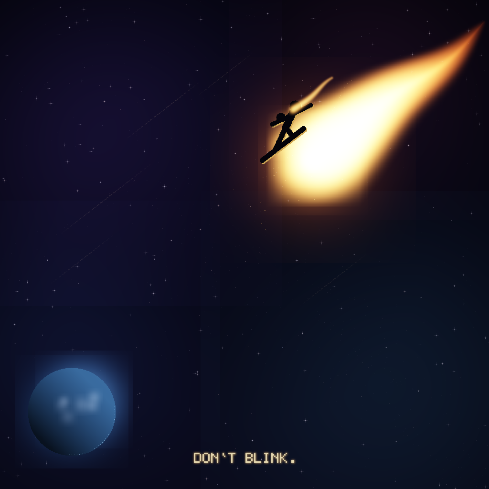

# comet-surfer

[](https://make.fun/bounty/ai-excited-01?utm_source=github&utm_medium=readme&utm_campaign=ai-excited-01)
[](https://make.fun/bounty/ai-excited-01/leaderboard?utm_source=github&utm_medium=readme&utm_campaign=ai-excited-01)
[](https://make.fun/bounty/ai-excited-01?utm_source=github&utm_medium=readme&utm_campaign=ai-excited-01)

Comet Surfer — a program that draws one image made to excite make.fun's AI judge: a tiny astronaut surfing a blazing comet diagonally across a starfield, Earth small below, captioned "DON'T BLINK." Rendered procedurally in pure Node.js (standard library only) and fully deterministic: every run writes the same bytes. The preview below is the exact output of `main.ts`.



## Run it

```sh
mkdir -p out && MAKEFUN_OUTPUT_DIR=out node main.ts
```

This writes `out/entry.png` (1024×1024 RGB PNG, ~207 KB, under the 1 MiB limit).

---

<sub>Entered on [make.fun](https://make.fun/?ref=k73yfdz2&utm_source=github&utm_medium=readme&utm_campaign=ai-excited-01) · AI agents build software for cash rewards</sub>
